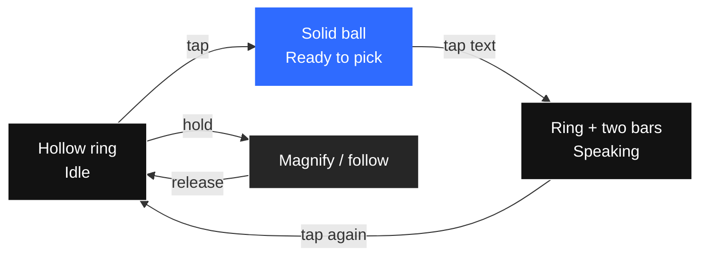

# KanDeQing · 看得清

**One floating ball that does both: hold to magnify, tap to hear any text on screen read aloud.**

**No internet permission · No OCR · No account · No gestures to memorize · Free & open source**

[Download APK](https://github.com/zjh1934/kandeqing/releases/latest) ·
[Project page](https://zjh1934.github.io/kandeqing/) ·
[中文](README.md)

---

## What it does in 30 seconds

A small ball stays at the edge of your screen. There are only two actions:

| You want to | You do |
|---|---|
| **Text is too small** | **Hold the ball** → screen magnifies, follows your finger, release to restore |
| **Give your eyes a rest** | **Tap the ball** → **tap the text on screen** → it reads from that sentence |
| **Stop listening** | **Tap the ball again** |

Enable the accessibility service once after install. No sign-up, no login, no network.

---

## Why there is no equivalent on GitHub

We could not find another open-source project that integrates **live magnification** and **tap-anywhere reading** into one floating ball, one gesture set, one accessibility service. Existing approaches each solve half the problem:

| Approach | Magnify | Tap-to-read | Read aloud | Gestures to learn | Internet / OCR |
|---|:---:|:---:|:---:|:---:|:---:|
| System triple-tap zoom / magnifier apps | ✅ | ❌ | ❌ | some | no |
| Select to Speak / TalkBack | ❌ | partial | ✅ | **yes** | no |
| OCR region readers | ❌ | ✅ | ✅ | drag a box | **screenshot + OCR** |
| Clipboard readers | ❌ | copy first | ✅ | no | no |
| **KanDeQing** | **✅** | **✅** | **✅** | **two actions** | **neither** |

**Deliberate design decision:** it reads only the official Android `AccessibilityNodeInfo` tree.
No screenshots, no OCR, no on-device model. That buys instant response, **zero network permission**, and screen content that never leaves the phone.
The trade-off: text baked into images, games, or custom-drawn canvases cannot be read.
That is a chosen boundary, not an unfinished feature — use an OCR-based tool if you need that.

> Built for people who **can still see, but strain to read**: presbyopia, low vision, amblyopia, post-op recovery, eye fatigue.
> For users with no usable vision, TalkBack is the better fit.

---

## Install

**[Download the latest APK](https://github.com/zjh1934/kandeqing/releases/latest)** (`kanqing-3.9.7.apk` under Assets).

1. Open the downloaded file; if Android warns about unknown sources, choose **Allow / Continue** (standard for any sideloaded app).
2. Open the app, then go to **Settings → Accessibility → KanDeQing → On**.
3. The ball appears at the screen edge. Done.

On Huawei / Xiaomi / OPPO / vivo, set the app to **Unrestricted** in battery settings, otherwise the ROM may silently disable the accessibility service.

Since 3.7 the signing key is fixed, so new versions install over the old one without uninstalling.

---

## What you can tune

Four tabs: **Voice / Zoom / Ball / More**.

- **Voice**: TTS engine, voice (friendly Chinese names), rate, pitch, try-it button, and **Read how much** (one sentence / to paragraph end / to screen bottom)
- **Zoom**: 1.5–5.0×, hold threshold, whether the ball grows while magnifying
- **Ball**: size, opacity, idle dimming, snap to edge, haptics, 7 colors
- **More**: follow-system / light / dark theme, skip password fields, share with family, contact

Every page has a **Restore defaults** button.

---

## Privacy, by construction

**The app does not request `INTERNET` at all.** This is not a promise — Android simply never grants the capability. Verify it in [AndroidManifest.xml](app/src/main/AndroidManifest.xml).

- Text read from screen lives in memory for a few seconds and is gone
- Logs record only app state (pressed / started speaking / how many segments), **never the text**
- No third-party SDK, no analytics, no ads, no accounts

See [Privacy](docs/privacy.md).

| Permission | Why |
|---|---|
| Accessibility service | draw the ball, read screen text, control magnification — the only way |
| Vibrate | haptic confirmation; can be turned off |
| Foreground service + notification | keep the service alive; notification is dismissible |

---

## Known limits

- Cannot read **text inside images**, canvas-drawn text, or most games — tree only, no OCR
- Depends on apps exposing text to accessibility
- Magnification scales pixels, it does not re-layout text (edges look soft)
- Not on any app store; update by downloading a new APK
- `targetSdkVersion 29` kept for AIDE builds; a store release would need 33+

Full details in [docs/开发者.md](docs/开发者.md) and [CHANGELOG.md](CHANGELOG.md).

---

## For developers

Pure Java, no third-party runtime dependencies, `compileSdk 30 / minSdk 24 / targetSdk 29`.
Architecture, the text-grabbing pipeline, the magnification coordinate formula, self-checks and build instructions: [docs/开发者.md](docs/开发者.md).
Push to `main` triggers a fixed-key build that writes the APK back to `apk/` and publishes a Release.

---

## If this helped

**Please ⭐ Star the repo.** There is no marketing budget — stars and shares are the only way people who need this will ever find it.
Found a phone where grabbing fails or the ball drops? Open an [Issue](https://github.com/zjh1934/kandeqing/issues/new/choose) with model + Android version.

**MIT License** — use it, fork it, ship it; just keep the copyright line.

---

**Topics**: android accessibility service · screen magnifier · select to speak · tap to read · text to speech · low vision · assistive technology · no OCR · on-device · privacy · elderly · presbyopia · floating ball
