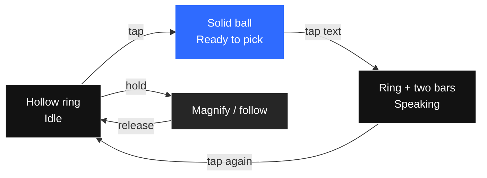

# KanDeQing · 看得清

**One floating ball that does both: hold to magnify, tap to hear any text on screen read aloud.**

**No internet permission · No OCR · No account · No gestures to memorize · Free & open source**

[Download APK](https://github.com/zjh1934/kandeqing/releases/latest) ·
[Project page](https://zjh1934.github.io/kandeqing/) ·
[中文](README.md)

---

## What it does in 30 seconds

Two independent floating balls, each draggable on its own:

| Ball | You want to | You do |
|---|---|---|
| **White** | Text is too small | **Hold** → screen magnifies, follows your finger, release to restore |
| **White** | Give your eyes a rest | **Tap white ball** → **tap the text on screen** → it reads from that sentence |
| **Green** | Just copied some text | **Tap the green speaker ball** → reads the clipboard; **tap again** while speaking to stop |
| | Want copies read automatically | Enable "Auto-read new clipboard content" on the Read tab (off by default) |

The green ball appears only when "Copy & Read" is on (default on). Its look follows
the open-source [TapRead](https://github.com/DLWangSan/tapread) green speaker ball.
There is **no double-tap and no gesture conflict** — one tap on the white ball is
always one tap, one tap on the green ball always reads the clipboard.

Android 10+ blocks background clipboard reads, so the green ball briefly obtains
an accessibility focus window to read. No screenshots, no OCR, no network;
clipboard text stays on device and is never written to logs. Android 13+ may show
its own "app read clipboard" toast — that is a system behavior.

**3.9.23 palette & opacity**: the muted "Qingyou" 7 colors are replaced by a
saturated "Bright" set (snow white / electric blue / emerald / amber / coral /
violet / aqua), each with an auto-chosen dark or white contrast rim so the ball is
easy to spot on both light and dark wallpapers. The speaking ring gets a contrast
under-ring, and its two bars plus the loading dots now use ball color with a dark
outline. **Opacity 100% is now truly opaque**: the old solid ball was a radial
gradient peaking at 90% and fading to fully transparent at the edge; now the inner
80% uses the full alpha and only the outer 20% is a short anti-alias falloff.
Release files are named `kandeqing-v<version>.apk` so every subscription entry is
distinguishable. Before / candidates / after previews are on the Release and Pages.

**Auto-read is best-effort on Android 10+**: the platform only grants clipboard
access to the default IME or the app currently holding input focus, and an
accessibility service is not an exemption. TapRead makes "copy, then tap the ball"
the default for exactly this reason. If nothing is read automatically, tap the
green ball. **Two kinds of links — do not mix them:**

**1) "New subscription / RSS 2.0 · Atom · JSON Feed" field** (a feed, paste either):

- [https://cdn.jsdelivr.net/gh/zjh1934/kandeqing@main/docs/feed.atom](https://cdn.jsdelivr.net/gh/zjh1934/kandeqing@main/docs/feed.atom) (Atom, verified `application/atom+xml`)
- [https://cdn.jsdelivr.net/gh/zjh1934/kandeqing@main/docs/feed.json](https://cdn.jsdelivr.net/gh/zjh1934/kandeqing@main/docs/feed.json) (JSON Feed, verified `application/json`)

The feed lists **every historical version** (from qiuqiu 2.0 up to the
current release, one entry per version), newest first. Each `enclosure` / `attachments` points directly at
that version's APK file, never at a Release HTML page, and carries version,
size and SHA256; CI appends a new entry on every release without dropping older
ones. For "always just the newest" use the fixed file URL in section 2.
**Do not** use GitHub's built-in `releases.atom` — its entries link to HTML
pages and cause "server returned HTML page".

**CDN cache**: jsDelivr caches same-named `@main` files for a few hours, so a
new version may appear in the feed slightly later; CI purges the cache after each
release. For an immediate, cache-free feed use the GitHub Pages mirror
`https://zjh1934.github.io/kandeqing/feed.atom`, or just use the fixed file URL
in section 2. The older `docs/subscribe.atom` / `subscribe.json` paths serve the
same file but may still show the old single-entry feed — always subscribe with
`docs/feed.atom` / `feed.json` above.

**2) "New download / direct file" field** (a file URL, not a feed):

- **Recommended** (verified 3.9.23, no CDN staleness, no redirect, permanent): [https://raw.githubusercontent.com/zjh1934/kandeqing/main/apk/kandeqing-latest.apk](https://raw.githubusercontent.com/zjh1934/kandeqing/main/apk/kandeqing-latest.apk)
- Fallback (jsDelivr): [https://cdn.jsdelivr.net/gh/zjh1934/kandeqing@main/apk/kandeqing-latest.apk](https://cdn.jsdelivr.net/gh/zjh1934/kandeqing@main/apk/kandeqing-latest.apk) — a same-named file can be one release behind at the CDN edge; for the newest, pick the first entry (3.9.23) in the feed, which uses a versioned path with no cache.
- Fallback B (GitHub Pages): [https://zjh1934.github.io/kandeqing/kandeqing-latest.apk](https://zjh1934.github.io/kandeqing/kandeqing-latest.apk)
- Release asset (302 to a signed URL): [https://github.com/zjh1934/kandeqing/releases/latest/download/kandeqing-latest.apk](https://github.com/zjh1934/kandeqing/releases/latest/download/kandeqing-latest.apk)
- For Obtainium-like apps, add the repo `https://github.com/zjh1934/kandeqing`
  and let it resolve the `.apk` asset; use [https://github.com/zjh1934/kandeqing/releases.atom](https://github.com/zjh1934/kandeqing/releases.atom) only for version notices.

Enable the accessibility service once after install. No sign-up, no login, no network.

---

## Why there is no equivalent on GitHub

We could not find another open-source project that integrates **live magnification** and **tap-anywhere reading** into one floating ball, one gesture set, one accessibility service. Existing approaches each solve half the problem:

| Approach | Magnify | Tap-to-read | Read aloud | Gestures to learn | Internet / OCR |
|---|:---:|:---:|:---:|:---:|:---:|
| System triple-tap zoom / magnifier apps | ✅ | ❌ | ❌ | some | no |
| Select to Speak / TalkBack | ❌ | partial | ✅ | **yes** | no |
| OCR region readers | ❌ | ✅ | ✅ | drag a box | **screenshot + OCR** |
| Clipboard readers | ❌ | copy first | ✅ | no | no |
| **KanDeQing** | **✅** | **✅** | **✅** | **two actions** | **neither** |

**Deliberate design decision:** it reads only the official Android `AccessibilityNodeInfo` tree.
No screenshots, no OCR, no on-device model. That buys instant response, **zero network permission**, and screen content that never leaves the phone.
The trade-off: text baked into images, games, or custom-drawn canvases cannot be read.
That is a chosen boundary, not an unfinished feature — use an OCR-based tool if you need that.

> Built for people who **can still see, but strain to read**: presbyopia, low vision, amblyopia, post-op recovery, eye fatigue.
> For users with no usable vision, TalkBack is the better fit.

---

## Install

**[Download the latest APK](https://github.com/zjh1934/kandeqing/releases/latest)** (`kandeqing-v3.9.23.apk` under Assets).

1. Open the downloaded file; if Android warns about unknown sources, choose **Allow / Continue** (standard for any sideloaded app).
2. Open the app, then go to **Settings → Accessibility → KanDeQing → On**.
3. The ball appears at the screen edge. Done.

On Huawei / Xiaomi / OPPO / vivo, set the app to **Unrestricted** in battery settings, otherwise the ROM may silently disable the accessibility service.

Since 3.7 the signing key is fixed, so new versions install over the old one without uninstalling.

---

## What you can tune

Four tabs: **Voice / Zoom / Ball / More**.

- **Voice**: TTS engine, voice (friendly Chinese names), rate, pitch, try-it button, and **Read how much** (one sentence / to paragraph end / to screen bottom)
- **Zoom**: 1.5–5.0×, hold threshold, whether the ball grows while magnifying
- **Ball**: size, opacity, idle dimming, snap to edge, haptics, 7 colors
- **More**: follow-system / light / dark theme, skip password fields, share with family, contact

Every page has a **Restore defaults** button.

---

## Privacy, by construction

**The app does not request `INTERNET` at all.** This is not a promise — Android simply never grants the capability. Verify it in [AndroidManifest.xml](app/src/main/AndroidManifest.xml).

- Text read from screen lives in memory for a few seconds and is gone
- Logs record only app state (pressed / started speaking / how many segments), **never the text**
- No third-party SDK, no analytics, no ads, no accounts

See [Privacy](docs/privacy.md).

| Permission | Why |
|---|---|
| Accessibility service | draw the ball, read screen text, control magnification — the only way |
| Vibrate | haptic confirmation; can be turned off |
| Foreground service + notification | keep the service alive; notification is dismissible |

---

## Known limits

- Cannot read **text inside images**, canvas-drawn text, or most games — tree only, no OCR
- Depends on apps exposing text to accessibility
- Magnification scales pixels, it does not re-layout text (edges look soft)
- Not on any app store; update by downloading a new APK
- `targetSdkVersion 29` kept for AIDE builds; a store release would need 33+

Full details in [docs/开发者.md](docs/%E5%BC%80%E5%8F%91%E8%80%85.md) and [CHANGELOG.md](CHANGELOG.md).

---

## For developers

Pure Java, no third-party runtime dependencies, `compileSdk 30 / minSdk 24 / targetSdk 29`.
Architecture, the text-grabbing pipeline, the magnification coordinate formula, self-checks and build instructions: [docs/开发者.md](docs/%E5%BC%80%E5%8F%91%E8%80%85.md).
Push to `main` triggers a fixed-key build that writes the APK back to `apk/` and publishes a Release.

---

## If this helped

**Please ⭐ Star the repo.** There is no marketing budget — stars and shares are the only way people who need this will ever find it.
Found a phone where grabbing fails or the ball drops? Open an [Issue](https://github.com/zjh1934/kandeqing/issues/new/choose) with model + Android version.

**MIT License** — use it, fork it, ship it; just keep the copyright line.

---

**Topics**: android accessibility service · screen magnifier · select to speak · tap to read · text to speech · low vision · assistive technology · no OCR · on-device · privacy · elderly · presbyopia · floating ball
