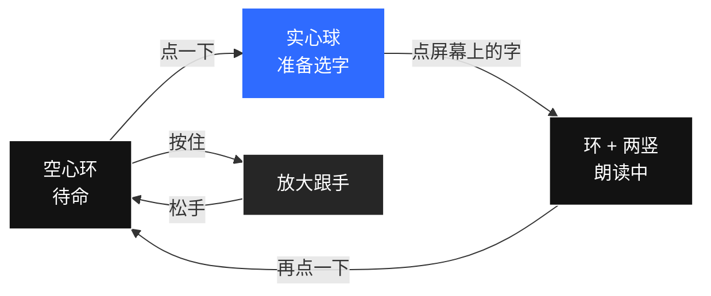

# 看得清

**一个悬浮球，把「按住放大」和「点一下念给你听」装进同一套动作里。**

**不联网 · 不上传 · 不用 OCR · 不学手势 · 免费开源**

[下载安装包](https://github.com/zjh1934/kandeqing/releases/latest) ·
[给长辈的图文说明](使用说明.md) ·
[项目主页](https://zjh1934.github.io/kandeqing/) ·
[English](README.en.md)

---

## 30 秒看懂

屏幕边上常驻一个小球，只有两个动作：

| 你想干什么 | 怎么做 |
|---|---|
| **字太小，看不清** | **按住球** → 画面放大，手指挪到哪看到哪，松手还原 |
| **不想用眼睛了** | **点一下球** → **点屏幕上那段字** → 从这句开始念给你听 |
| **不想听了** | **再点一下球** |

装完开一次无障碍，以后不用管。**不需要注册、不需要登录、不需要联网。**

---

## 为什么 GitHub 上找不到第二个

把「**实时放大**」和「**点哪读哪**」做进同一个悬浮球、同一套手势、同一个无障碍服务里的，我们目前没有找到同类开源项目。常见的方案各自只解决一半：

| 方案 | 放大 | 点哪读哪 | 读屏 / 朗读 | 要学手势 | 要联网 / OCR |
|---|:---:|:---:|:---:|:---:|:---:|
| 系统三击放大 / 放大镜 App | ✅ | ❌ | ❌ | 部分 | 否 |
| Select to Speak / TalkBack | ❌ | 部分 | ✅ | **要学** | 否 |
| OCR 选区朗读类 | ❌ | ✅ | ✅ | 要框选 | **要截图 + OCR** |
| 剪贴板朗读类 | ❌ | ❌（要先复制） | ✅ | 否 | 否 |
| **看得清** | **✅** | **✅** | **✅** | **两个动作** | **都不需要** |

**我们的取舍很明确**：只走 Android 官方 `AccessibilityNodeInfo` 树，不截图、不做 OCR、不引入模型。
换来的是**点一下就出声、零网络权限、屏幕内容一步都不出手机**；代价是图片里的字、游戏/Canvas 自绘的字读不到。
这不是缺陷没修完，是刻意选的路 —— 需要读图片里的字，OCR 类工具更合适。

> 面向的是**还看得见、但看得很吃力**的人：老花、低视力、弱视、术后恢复、看一会儿就眼酸。
> 完全看不见的朋友，系统自带的 TalkBack 更合适。

---

## 装上就能用

**👉 [下载最新版 APK](https://github.com/zjh1934/kandeqing/releases/latest)**（在 Assets 里点 `kanqing-3.9.7.apk`）

1. 点开下载好的文件 → 提示「未知来源」时选 **允许 / 继续**（安卓对所有非商店应用的统一提醒，不是软件有问题）
2. 装完打开 → 按首页提示去 **设置 → 无障碍 → 看得清 → 打开**
3. 屏幕边上出现小球，就好了

| 手机 | 无障碍入口 |
|---|---|
| 华为 / 荣耀 | 设置 → 辅助功能 → 无障碍 |
| 小米 / 红米 | 设置 → 更多设置 → 无障碍 |
| OPPO / 一加 / realme | 设置 → 其他设置 → 无障碍 |
| vivo / iQOO | 设置 → 快捷与辅助 → 无障碍 |
| 三星 | 设置 → 辅助功能 → 已安装的应用程序 |
| Pixel / 原生 | 设置 → 系统 → 无障碍 |

> **球过一会儿没了？** 部分国产 ROM 的省电策略会自动关掉无障碍服务，
> 到「电池 / 省电」把「看得清」设成 **不限制** 即可。

完全不懂手机的长辈，请看 **[给长辈的图文说明](使用说明.md)**，每一步都配了照着做就行的话。
也可以把 **[下载页](https://zjh1934.github.io/kandeqing/)** 直接发给家人。

**从 3.7 起签名密钥固定，新版可以直接覆盖安装**，不用卸载。

---

## 三个真实场景

**① 微信里孩子发来一大段话**
字号调到最大还是费劲 → 点球 → 点第一句 → 从这句一路念下去。
只想听一句，把「朗读 → 读多少」调成「只读一句」。

**② 药盒说明书、快递单号**
按住球放大，手指挪到「用法用量」那行，看清了松手；数字怕看错，点一下让它念一遍。

**③ 看十几分钟就眼睛酸**
按住 = 放大看，点一下 = 用耳朵听，两种休息方式随手切，不用换 App、不用切设置。

---

## 能调什么

打开 App，底部四个标签页：**声音 / 调节 / 悬浮球 / 更多**。

- **声音**：语音引擎、音色（中文短名）、语速、音调、试听、**读多少**（只读一句 / 读到段末 / 读到屏底）
- **调节**：放大倍率 1.5–5.0、按住多久算放大、放大时球是否跟着变大
- **悬浮球**：大小、不透明度、闲置淡出、松手贴边、震动反馈、7 种颜色
- **更多**：主题跟随系统 / 浅色 / 深色、密码框不朗读、一键推荐给家人、联系作者

每页底部都有「恢复默认」，调乱了点一下就好。

---

## 隐私：从系统层面就传不出去

**这个 App 根本没有申请 `INTERNET` 权限。** 不是「我们承诺不上传」，是 Android 不给它这个能力 ——
可以直接翻 [AndroidManifest.xml](app/src/main/AndroidManifest.xml) 核对。

- 屏幕上读到的字只在内存里活几秒，读完就没了
- 日志只记软件自己的状态（按下了、开始朗读了、抓到多少段），**不记任何读到的文字**
- 没有第三方 SDK、没有统计、没有广告、没有账号体系

详见 **[隐私说明](docs/privacy.md)**。

| 权限 | 用途 |
|---|---|
| 无障碍服务 | 画球、读屏幕文字、控制放大 —— 唯一途径 |
| 震动 | 点中/开始读/读不到时给一下触感，可在「悬浮球」页关 |
| 前台服务 + 通知 | 让系统别随手杀掉，通知可划掉 |

---

## 常见问题

**球没出来？** 确认「设置 → 无障碍」里「看得清」还开着；App 首页那行字会直接告诉你卡在哪一步。

**点了字说「这里没读到文字」？** 会有一记长震明确告诉你没抓到，不是呆在那里。
多数情况是点在行间距/留白上，往字上再点一次即可；游戏、纯图片、自绘界面不向无障碍提供文字，读不到是正常的。

**为什么点一下到出声有等待？** 点字后球里一排小点会转圈，出声才换成两竖线 —— 不会让你猜是不是卡住了。

**放大之后字发毛？** 放大是把屏幕像素拉开，不会重新排版，这是系统放大的固有代价。想又大又清楚，用朗读。

**声音不好听 / 太快？** 「声音」页换引擎和音色、调语速，旁边有「恢复默认」。

---

## 已知边界（如实写）

- 读不到**图片里的字**、Canvas 自绘文字、多数游戏界面 —— 只走无障碍树，不做 OCR
- 依赖 App 向无障碍暴露文字；个别 App 不提供节点
- 放大是像素放大，边缘会毛
- 未上架应用商店，升级靠自己下载新版（可直接覆盖安装）
- `targetSdkVersion 29`：为保留 AIDE 构建能力；上架商店需提到 33+ 并补前台服务类型声明

完整清单见 **[已知限制与开发者文档](docs/开发者.md)**。

---

## 给开发者

- [架构、抓字链路、放大坐标公式、自检与构建](docs/开发者.md)（从 README 搬出来的技术详版）
- [更新记录](CHANGELOG.md) · [贡献指南](CONTRIBUTING.md) · [安全与反馈](SECURITY.md)
- 纯 Java，无第三方运行时依赖，`compileSdk 30 / minSdk 24 / targetSdk 29`
- push 到 `main` 会用固定密钥自动出包、回传 `apk/` 并发布 Release

---

## 如果它帮到了你

**点个 ⭐ Star 吧。** 这个项目没有推广预算，Star 和转发是它唯一能被更多需要的人看见的方式。
发现抓字不准、某个机型球会掉，欢迎提 [Issue](https://github.com/zjh1934/kandeqing/issues/new/choose) —— 附上机型和系统版本就够。

**MIT License** · 随便用、随便改、拿去二次发布都行，保留一行版权声明即可。

---

**关键词**：无障碍 · 低视力 · 弱视 · 老花 · 放大镜 · 屏幕放大 · 点读 · 朗读 · 悬浮球 · 老人手机 · 视疲劳 · 不联网 · 本地处理 · `android accessibility service` · `screen magnifier` · `select to speak` · `tap to read` · `text to speech` · `no OCR` · `on-device` · `assistive technology`
